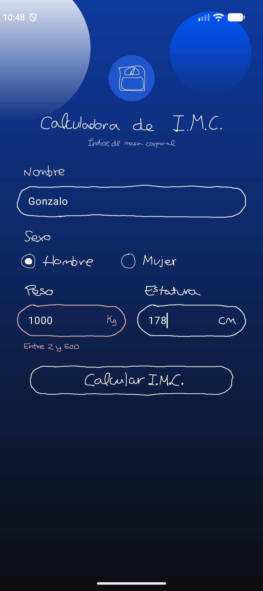
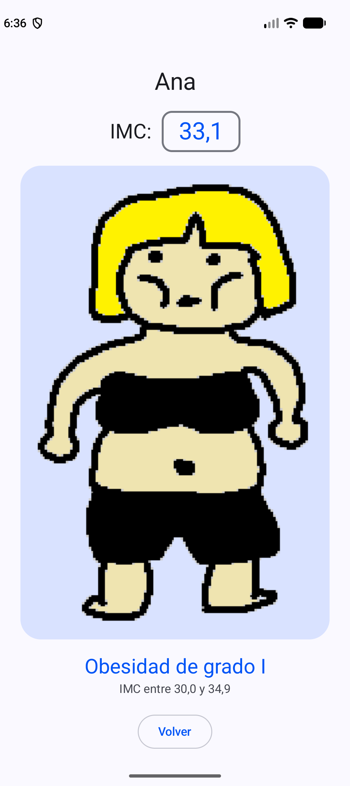
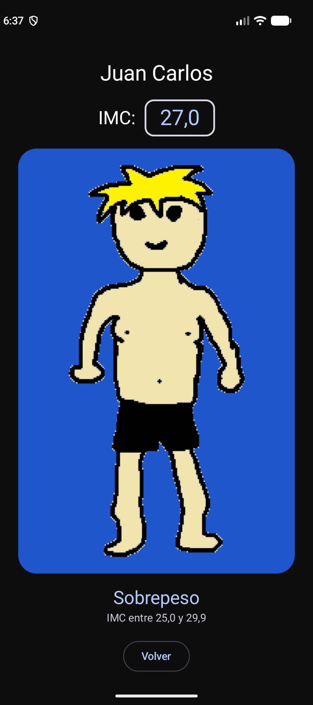
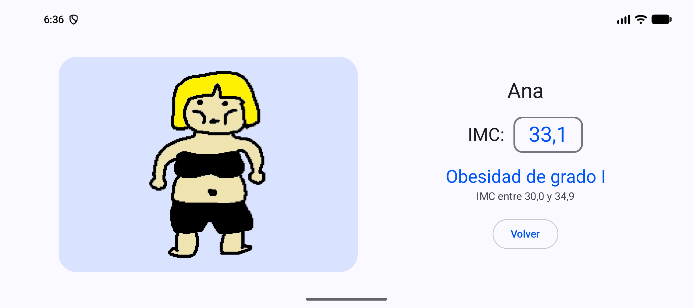

# Calculadora IMC

App Android hecha 100 % con **Jetpack Compose** que calcula el **índice de masa corporal (IMC)** y muestra el estado de la persona según la clasificación oficial de la OMS, con una ilustración distinta para cada estado y para cada sexo.

No usa layouts XML, librerías de navegación ni ViewModel: solo **estado + funciones composables**.

<p align="center">
  
  
  
</p>

## Cómo funciona

1. **Formulario**: escribes tu nombre, eliges el sexo e introduces el peso (kg) y la estatura (cm).
2. Pulsas **Calcular IMC**. El botón solo se activa cuando están todos los campos rellenos.
3. **Resultado**: aparece tu nombre, el IMC con un decimal, la ilustración que te corresponde y tu estado (valor cualitativo).
4. **Volver** te lleva de nuevo al formulario, vacío.

### La fórmula

```
IMC = peso (kg) / estatura (m)²
```

- La estatura se escribe en centímetros y la app la pasa a metros.
- El peso admite coma o punto decimal: `72,5` y `72.5` valen igual.
- El IMC se redondea a un decimal **antes** de clasificarlo, para que el número que ves y el estado siempre coincidan.
- **El sexo no forma parte de la fórmula**: solo sirve para elegir la ilustración.

### Rangos oficiales (OMS)

Clasificación del IMC en adultos de la Organización Mundial de la Salud: 6 categorías.

| # | IMC (kg/m²) | Categoría |
| --- | --- | --- |
| 1 | menor de 18,5 | Bajo peso |
| 2 | desde 18,5 hasta menos de 25 | Peso normal |
| 3 | desde 25 hasta menos de 30 | Sobrepeso |
| 4 | desde 30 hasta menos de 35 | Obesidad de grado I |
| 5 | desde 35 hasta menos de 40 | Obesidad de grado II |
| 6 | 40 o más | Obesidad de grado III |

### Validación

| Campo | Valores aceptados |
| --- | --- |
| Peso | de 2 a 500 kg |
| Estatura | de 50 a 250 cm |

Si un valor está fuera de rango, el campo se pone en rojo con un aviso y no se calcula nada. El aviso desaparece al volver a escribir.

## Estructura del proyecto

```
com.gonzalo.calculadora_imc
├── MainActivity.kt          → decide QUÉ pantalla se ve (un único estado: el resultado)
├── imc
│   └── Imc.kt               → lógica: fórmula, rangos e ilustraciones (sin interfaz)
└── ui
    ├── FormularioScreen.kt  → pantalla 1: nombre, sexo, peso y estatura
    ├── ResultadoScreen.kt   → pantalla 2: IMC, ilustración y estado
    ├── LogoCircular.kt      → componente reutilizable
    └── theme                → colores, tipografía y temas claro/oscuro
```

### Ideas de Compose que se practican

- **Estado que baja, eventos que suben.** El formulario no abre el resultado: solo avisa con `onCalcular(resultado)`. `MainActivity` guarda ese resultado y Compose cambia de pantalla solo.
- **Un solo estado para navegar.** `resultado == null` muestra el formulario; con un resultado se muestra la pantalla de resultado. **Volver** lo pone otra vez a `null`.
- **Listas inmutables.** Los rangos (`RANGOS_IMC`) y las ilustraciones (`ILUSTRACIONES`) son `listOf(...)` y `mapOf(...)`: no se pueden modificar porque nunca cambian.
- **`rememberSaveable` con un `Saver` propio.** Así el resultado sobrevive al girar el móvil.
- **Diseño adaptable.** Con el móvil en horizontal, el resultado pone la ilustración a la izquierda y los datos a la derecha.

<p align="center">
  
</p>

## Las ilustraciones

Los 12 dibujos están hechos a mano: uno por categoría y por sexo. Están en `app/src/main/res/drawable`:

```
imc_hombre_1.png … imc_hombre_6.png
imc_mujer_1.png  … imc_mujer_6.png
```

El número es la columna **#** de la tabla de arriba (1 = Bajo peso … 6 = Obesidad de grado III).

Son PNG con fondo transparente, recortados a su contenido. La app los ajusta al marco sin deformarlos.

Para cambiar un dibujo, sustituye el PNG por otro con **el mismo nombre** y vuelve a ejecutar la app. No hay que tocar código.

> El nombre debe ir en minúsculas, sin espacios ni tildes, o Android no lo reconoce.

## Ejecutarlo

1. Abre la carpeta del proyecto en **Android Studio** (*File → Open…*).
2. Espera a que termine la sincronización de Gradle.
3. Elige un emulador o un móvil y pulsa **▶ Run 'app'**.

Requisitos: Android 8.0 (API 26) o superior.

## Créditos

- Basado en el tutorial [Login_compose](https://github.com/sulbaranjc/Login_compose) de Juan Carlos Sulbaran Gonzalez y en mi versión del login, [Login_compose](https://github.com/Gonzarrrami/Login_compose).
- El estilo del formulario es una adaptación de [Login Page](https://www.figma.com/community/file/1244126388179404671/login-page), de Adarsh, publicado en la comunidad de Figma con licencia [CC BY 4.0](https://creativecommons.org/licenses/by/4.0/).
- Rangos del IMC: clasificación de la OMS (Organización Mundial de la Salud) para adultos.

> Esta app es un ejercicio de clase. El IMC es una medida orientativa y no sustituye la valoración de un profesional sanitario.
